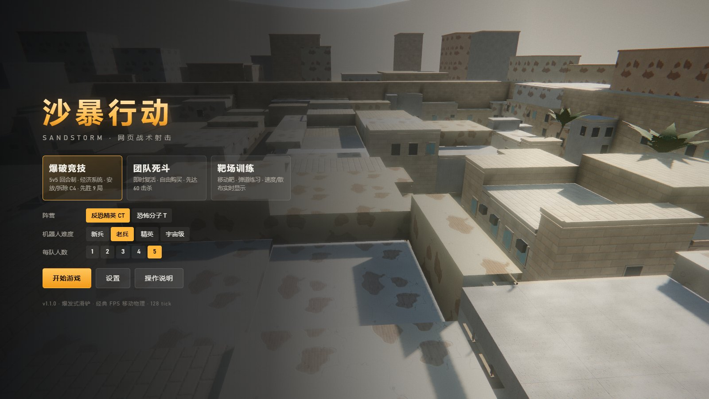
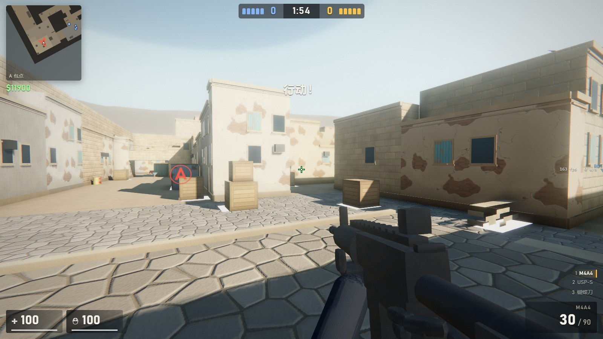
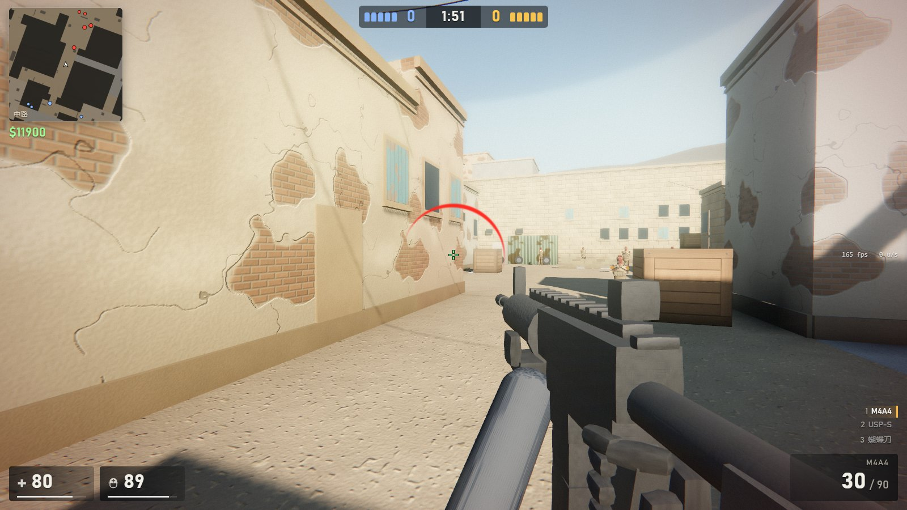

# 沙暴行动 · SANDSTORM

网页版战术射击游戏：拟真战术射击手感 + 爆发式滑铲。纯静态，无需安装，无需联网。

> **在线试玩**：<https://kwusv55.github.io/Cla-Go/> —— 点开即玩，无需下载。



| A 包点 | 中路交火 |
| --- | --- |
|  |  |

## 启动

双击 `index.html`（推荐 Edge / Chrome 最新版），点「开始游戏」即可。
点击后鼠标会被锁定并自动全屏，按 `Esc` 暂停（长按 `Esc` 退出全屏）。

> 全屏是为了启用浏览器的「键盘锁定」：只有全屏时网页才能接管 `Ctrl+W`、`Ctrl+D` 等浏览器快捷键。
> 否则 `Ctrl` 下蹲 + 移动键会触发浏览器快捷键，抢走鼠标锁定（表现为像按了 Esc 一样跳出暂停菜单）。
> 不想全屏可在 设置 → 鼠标与移动 关闭「全屏 + 键盘锁定」，并改用 `C` 下蹲。

## 模式

| 模式 | 说明 |
| --- | --- |
| 爆破竞技 | 5v5 回合制，经济系统，T 安放 / CT 拆除 C4，先胜 9 局，第 8 局后交换攻守 |
| 团队死斗 | 即时复活，出生 20 秒内可免费换枪，先达 50 击杀 |
| 靶场训练 | 无限弹药，移动靶，右侧实时显示速度 / 散布 / 后坐序号 |

机器人难度：新兵 / 老兵 / 精英 / 宇宙级（反应时间、跟枪、压枪、爆头率、滑铲频率逐级提升）。
机器人会在赶路、转点、回防和遭遇敌人时滑铲。

敌我识别：CT 为深蓝灰制服 + 黑色防弹背心 + 头盔，臂章蓝色；T 为沙土色衣裤 + 棕色胸挂 + 暗红头巾蒙面，臂章橙色。
队友头顶显示阵营色标记和名字；准星对准可见敌人时，准星下方显示红色「敌人 名字」。

## 操作

| 按键 | 功能 |
| --- | --- |
| W A S D | 移动 |
| Shift | 静步（设置里可改为冲刺模式，此时 Alt 静步） |
| Ctrl / C | 蹲下；**接近满速奔跑时按下 = 滑铲**，滑铲中起跳保留惯性 |
| 空格 | 跳跃 |
| 左键 / 右键 | 开火 / 狙击开镜、刀重击、投掷物低抛 |
| R / F | 换弹 / 检视（蝴蝶刀有完整的收刀、指间滚刀、甩开检视动作） |
| 1-5、Q、滚轮 | 主武器 / 副武器 / 刀 / 投掷物 / C4，Q 快速切换 |
| E | 拾取武器、安放（也可按住左键）/ 拆除 C4 |
| G | 丢弃当前武器 |
| B / Tab | 购买菜单 / 计分板 |

## 手感参数

- 128 tick 固定步长物理，经典 FPS 移动模型：加速 5.5、摩擦 5.2、空中加速 12、重力 800u/s²
- M4A4 跑速 225u/s，静步 117u/s，蹲走 77u/s；急停到“精准速度”约 70ms
- 跳跃高度 57u，蹲跳可上 64u 木箱；落地体力惩罚限制连跳
- 灵敏度采用经典 FPS 弧度基准（每单位 0.022°），支持原始鼠标输入
- 散布 = 基础 + 移动 + 空中 + 落地 + 连射累积；AK/M4 固定压枪弹道，停火后回复
- 爆头 ×4、胸 ×1、腹 ×1.25、腿 ×0.75；护甲/头盔减伤；距离衰减；木门/木箱/薄墙/铁皮可穿透
- 头部命中区是贴合头模的椭球（头盔算头部），头顶上方的空气和脖子不算爆头

## 近战武器

设置 → 鼠标与移动 →「近战武器」可选蝴蝶刀（默认）或匕首，下次出生生效。
蝴蝶刀由刀刃和两片镂空刀柄组成，各自绕销轴转动：掏出时甩开，按 `F` 检视。

## 阵亡视角

阵亡后镜头从眼睛位置拉到自己尸体后上方，可用鼠标自由环绕查看，不会自动锁定击杀者。
爆破模式 2.5 秒后切换到队友观战（左/右键切换）。

## 更新记录

- **v1.1.0**：修复 AWP 开镜下蹲时 Ctrl 组合键触发浏览器快捷键导致退出（全屏键盘锁定）；机器人整体降低强度并会滑铲；头部命中盒改为贴合椭球、脖子不再算爆头；阵亡视角改为可自由环绕；重做两队人物模型并加入敌我标识；新增蝴蝶刀及检视动画
- **v1.0.0**：首个版本

## 文件结构

```
index.html          入口
css/style.css       界面样式
lib/                three.js r147 及后处理（本地化，离线可用）
js/core.js          常量、设置、输入
js/audio.js         程序化合成音效 + HRTF 3D 定位
js/textures.js      程序化 PBR 纹理
js/world.js         AABB 碰撞世界、射线、碰撞盒扫掠
js/map.js           地图生成 + 顶点 AO 烘焙
js/nav.js           导航网格 + A*
js/weapons.js       武器数据与弹道
js/models.js        武器/角色模型（蒙皮）
js/effects.js       粒子、贴花、曳光、弹壳、烟雾
js/ragdoll.js       布娃娃
js/actor.js         移动物理与武器状态机
js/bot.js           机器人 AI
js/viewmodel.js     第一人称持枪动画
js/hud.js           HUD / 雷达 / 购买菜单
js/game.js          对局逻辑与模式
js/main.js          渲染管线、菜单、主循环
docs/               截图
```

## 技术要点

- **零外部素材**：音效全部用 Web Audio 程序化合成（含 HRTF 3D 定位），纹理全部用代码生成的 PBR 贴图（反照率 + 法线 + 粗糙度），模型全部由几何体放样拼装，地图由网格雕刻生成并对顶点烘焙环境光遮蔽。整个项目不含任何图片、音频或模型文件。
- **可离线运行**：three.js 及后处理链以 UMD 形式本地化在 `lib/`，直接双击 `index.html` 即可运行，无需服务器、无需联网、无构建步骤。
- **手感一致**：128 tick 固定步长物理 + 渲染插值，移动、加速、急停、后坐与散布均按经典 FPS 的数值模型实现。

## 许可

本项目原创代码以 [MIT 许可](LICENSE) 开源。

`lib/` 目录下的 three.js 及其示例代码为第三方组件，版权归原作者所有，同样以 MIT 许可分发，详见 [THIRD-PARTY-NOTICES.md](THIRD-PARTY-NOTICES.md)。

本项目为原创同人作品，与任何商业游戏及其发行商无关联，未使用任何第三方游戏的美术、音频或代码资源。
